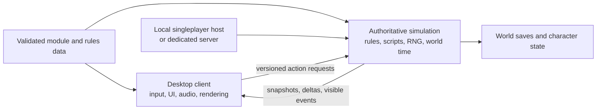

# Feature and implementation roadmap

**Status audited October 13, 2026.** Companion to the [game pitch](GAME_PITCH.md). This is an implementation plan, not a release-date promise or a percentage-complete estimate.

The baseline is the supplied 187-page *Arcanum Players Guide*. References below are **physical PDF pages**, linked to the private [local manual conversion](../local-data/reference/manual/manual.html#page-001). They were checked against visible page crops: the PDF contains printer spreads with hidden neighboring text, so raw `pdftotext` page boundaries are not reliable. Manual files, facsimiles and retail assets remain outside the public source distribution. Page numbers still identify the source when those local links are unavailable.

## What exists today

| Evidence | Verified boundary |
| --- | --- |
| [Current development notes](DEVELOPMENT.md) and [real-door smoke](../ember-electron/door-smoke.cjs) | A Linux desktop checkpoint: nine Bates Mansion sectors, converted prototypes and objects, animated controlled movement, blocked/void rejection, native floor/door clicks, recovered roofs and static lighting. One door scenario verifies approach, open/close, traversal, occupied-close rejection and restoration. The separate owned workshop supplies a small inventory scenario without retail assets. |
| [Local host lifecycle](../ember-electron/local-server.cjs), [headless authority](../@openarcanum/agate/src/server/authority/AuthorityServer.js), [ClientEngine](../@openarcanum/agate/src/client/ClientEngine.js) | Desktop startup owns a headless Node child on an ephemeral loopback port. The server loads converted collision/prototypes, validates owner move/use/inspect/inventory/take/put/take-all/pickup/drop/talk/reply/journal/character/save/load/pause/resume commands and advances one actor and a subset of door states. The client interpolates movement and applies committed poses. Container approach, private inspection, whole Generic/standalone-Key Take/Put and atomic Take All share this boundary; transfers require known actor ownership and a fresh inspection revision and current container-key access. Known containers must belong to the fixed attainable set and permit current access. The owned guide adds a conditioned conversation, private quest journal and atomic XP/level/unspent-CP reward. One manual local slot saves position, managed doors, supported ownership and this quest/progression; complete campaign persistence and playable co-op are absent. |
| [Authority socket tests](../@openarcanum/agate/tests/authority-network.test.cjs), [host lifecycle tests](../ember-electron/local-server.test.cjs) | Real authenticated owner/observer sockets exercise matching state, replay rejection, autonomous movement, door-use validation and cleanup; failed startup releases ZIP handles. Local host tests exercise process ownership and shutdown. The historical `ServerNetwork`/`ServerEngine` scaffolding remains a separate unfinished path. |
| [Checkpoint smoke](../ember-electron/checkpoint-smoke.cjs) and [validation notes](DEVELOPMENT.md#development-status) | The real Bates client saves position/open door, changes both, restores artwork/collision and matches an independent observer, then saves the closed-door baseline through native UI input. Headless tests cover fresh-host restore, content compatibility and failure cases. Complete campaign state remains outside this slot. |
| [Combat system](../@openarcanum/agate/src/shared/entity/systems/Combat.js) and [Spell component](../@openarcanum/agate/src/shared/entity/components/Spell.js) | Combat is scaffolding and spell data is retained without original spell rules. Historical AI/combat demonstrations are disabled in the headless host and rendering checkpoint. |
| [Ember UI](../app/) and [authored GUI definitions](../@openarcanum/asset-db/scripts/) | Native panels expose server-controlled container inspection, whole Generic/standalone-Key Take/Put, atomic Take All, private actor inventory, character progression and the owned guide's conversation/journal. Put targets the selected freshly inspected container; retaking uses its updated private contents. Historical character, inventory-grid, dialogue and other windows remain scaffolding without complete rules. These GUI scripts are not an original-game script interpreter. |
| [Converter package](../@openarcanum/asset-converter/) and [local recovery workflow](DEVELOPMENT.md#recover-roofs-and-static-light-metadata) | Partial text/rule conversion plus a narrow SEC roof/light recovery tool. A reproducible, complete retail-installation import pipeline remains to be built. |
| [Inventory recovery evidence](INVENTORY_RECOVERY.md) | Original Bates MOB records establish reciprocal ownership for all 32 items, including 13 container memberships. The local MOB/prototype recovery tool reconstructs inventory lists, sparse slots and item parents with reciprocal checks. Private inspection uses those links. Original nonempty containers remain locked and the separate controlled actor's inventory remains unknown; the owned workshop supplies the positive Take/Put witness. |
| [Owned inventory workshop](../examples/inventory-workshop/README.md), [generator](../examples/inventory-workshop/generate.cjs) and [focused tests](../@openarcanum/agate/tests/workshop-module.test.cjs) | A redistributable miniature map, actor, crates, token, key, doors, guide and procedural PNG artwork run without a retail installation. The known-empty actor can take the crate's whole Generic item, put it back and retake it, preserving identity and item count. Its 89 generated files include a key crate, authored locked door and locked keepsake crate: take the standalone key, open the door, transfer the keepsake, put the key away and restore supported poses and ownership. An authored ground pebble supports pickup/drop and saved floor placement. The guide's small quest completes only when that exact pebble is held, without consuming it, awarding 2,100 XP and level-up CP once. Schema 5/rules v8 checkpoints preserve its private journal and consistent progression alongside supported world state. Equipment, stacks, weight, original dialogue/script execution and a supported mod API remain unfinished. |

**Status labels:** **Verified** means a named current scenario passes; **Partial** means a useful subset works with stated limits; **Prototype** means code/data/UI exists without complete rules or integration; **Absent** means no validated implementation of the required behavior. “Absent” does not imply that every related file is missing.

## The architecture we are targeting

This is a new design commitment, now begun with local authoritative movement, narrow door use, Generic/standalone-Key Take/Put, an owned conversation and quest, and checkpoints for position, doors, supported ownership and that quest. The manual's original multiplayer server/client model ([104](../local-data/reference/manual/manual.html#page-104)) is useful precedent, but does not establish that the original campaign supports our proposed co-op model. The diagram includes planned campaign rules, complete saves and dedicated hosting beyond the current checkpoint.

### Authority and process boundaries

- **Singleplayer:** the current desktop starts an owned local server process on loopback and connects one normal client through protocol version 1. No internet service or account is required. Server-controlled pause/resume freezes movement, pending approaches and client world animation; its availability is a host policy. One manual local slot saves position, managed doors, supported ownership and the owned quest/progression ledger; a fresh host begins at the development spawn until **Load checkpoint** is selected. Current checkpoints require schema 5 and rules `movement-doors-ownership-progression-v8`. Module/version negotiation, multiple save slots, complete campaign persistence, accelerated rest and shutdown saves remain targets.
- **Co-op:** connect multiple clients to a listen host or headless dedicated server. A listen host runs the same server executable; its local player has the same gameplay command validation as guests. The server owns character permissions, world time, inventories, quests, RNG outcomes and persistence.
- **MMORPG-oriented hosting:** retain a server-authoritative world model and add interest areas, persistence operations, admission controls and observability as requirements become measurable. Do not promise a population, seamless world, sharding or uptime before proving their budgets. Campaign instances and persistent community modules can use the same rules without sharing all host policies.
- **Client:** owns camera, presentation, input bindings, accessibility and UI layout. It sends intentions such as move, use, equip, reply or craft, rather than authoritative damage, inventory balances or quest completion. Prediction/interpolation is presentation; server corrections and rejected actions must reconcile cleanly.
- **Server:** executes shared rule code independently of DOM, Pixi and Electron. Commands have authenticated actor ownership, an identifier for duplicate detection, precondition validation and explicit results. A duplicate transfer or quest reply must not grant its reward twice. Ordering, saved random state and versioned rules make scenarios reproducible.
- **Tools:** import and validate content, compile authored modules and inspect saves outside the simulation. Servers need rule/geometry metadata; texture decoding and original artwork are client concerns. Do not require an Electron process to host a game.

Preserve the working Bates renderer as a regression target while adding authoritative rules. The current host uses shared map/collision/prototype classes with legacy simulation/render systems disabled; it does not inherit the unfinished historical multiplayer handlers. Add future singleplayer rules behind this boundary rather than building a second rules implementation in the rendering client.

### Co-op semantics to specify before implementation

The proposed first mode is a **shared campaign for 2–4 players**, with a server-owned save and characters bound to that campaign. It is distinct from recreating the original multiplayer-module mode unchanged.

| Concern | Original baseline | Proposed initial campaign co-op policy |
| --- | --- | --- |
| Quests and one-time rewards | Most multiplayer quests can be completed only once; other players see that another participant completed them ([110](../local-data/reference/manual/manual.html#page-110)). | World facts and irreversible quest outcomes are shared. Personal knowledge, journal visibility and eligibility remain explicit per-character state. One transaction commits a quest outcome and its reward; late joiners receive the resulting world, not duplicate quest items. |
| Dialogue | Responses depend on the speaking character's traits, inventory and knowledge ([66–67](../local-data/reference/manual/manual.html#page-066)). | One speaker owns an NPC conversation at a time; nearby consenting party members can observe. The speaker's traits govern checks. Important campaign branches can require a party vote; timeout, speaker disconnect and combat interruption have defined outcomes. No simultaneous conflicting reward commits. |
| Parties and followers | Nearby party members share XP; players retain their own followers and alignment consequences ([112–113](../local-data/reference/manual/manual.html#page-112)). | Start with the original proximity/ownership distinction, with the distance rule measured from the reference. Share quest facts separately from XP. Followers obey their owner's commands unless that owner explicitly delegates control. |
| Loot and economy | Original inventory and barter transfer actual items and coins ([48–51](../local-data/reference/manual/manual.html#page-048), [68–70](../local-data/reference/manual/manual.html#page-068)). | Unique server item IDs and atomic transfers; two players racing for one item receive one winner and one clear rejection. Party loot permissions are a host policy, never duplicate item instances per client. |
| Time, rest and travel | Original multiplayer disables sleep, world-map travel and turn-based combat ([113](../local-data/reference/manual/manual.html#page-113)). | Real-time is the first co-op combat mode. Party-wide rest or world travel requires everyone affected to be ready; reject it during danger or when participants would be stranded. Never accelerate an entire public persistent world for one party. Turn-based co-op remains a separate product decision. |
| Saves, disconnects and death | Original multiplayer continues after a player's death, allows resurrection, and lasts until the server player quits ([104](../local-data/reference/manual/manual.html#page-104), [113](../local-data/reference/manual/manual.html#page-113)). | Server checkpoints persist the campaign. Reconnection restores the authorized character and committed consequences. Define disconnect behavior during combat and the dead-player interface; reconnecting must not become free healing or a fresh inventory. No host migration in the first release. |

These are proposals to test with players, not claims about original campaign behavior or completed code.

## Delivery milestones and gates

Milestones are ordered by dependency and demonstrated outcomes. Small authoring tools and mod schema work begin in M0; the supported extension ecosystem arrives in M5. No calendar estimate is meaningful before the first complete gameplay slice.

| Milestone | Deliverable | Exit gate |
| --- | --- | --- |
| **M0 — Reproducible content and reference** | Identify the supported game/version/patch profile; document the import pipeline and converted schemas. Create an owned miniature module and a reference-game harness. Keep Bates regression coverage. | A clean checkout imports a declared local installation or reports a precise unsupported format; validates IDs, coordinates, resources, scripts and map links; launches the owned module without retail assets. Named reference scenarios have reproducible setup/actions and observations. |
| **M1 — Local authority parity** | A headless server owns the existing map, actor, clock and movement. One local client uses a versioned command/snapshot protocol. | The Bates movement/blocking/native-input scenario passes through loopback. Direct server tests reject an unauthorized actor, invalid destination and duplicate command. A second observer sees the same actor state. Stop/start and connection failure leave no orphan host. |
| **M2 — Complete roleplaying slice** | Character creation and derived state; container transfer/equipment; one conditioned conversation and quest; one specified encounter; transactional save/reload; one map transition and return. | The same slice runs in the owned module and corresponding reference-backed original content. Save/reload restores actor, item identity, quest/NPC/follower state, timers and RNG. No reward or item duplication. A headless scenario and real client UI both pass. |
| **M3 — Original systems and campaign coverage** | Expand magic, technology, social/stealth routes, followers, travel and original scripts; then work through the campaign graph and endings. | Track coverage by scenario and imported content, including alternative solutions and failure paths. A declared compatibility profile completes the campaign from a fresh character and from versioned saves. Every unsupported opcode/content record is reported. One spell or map is not coverage of its whole family. |
| **M4 — Co-op vertical slice** | The M2/M3 systems run for 2–4 clients with party, conversation, loot, time and reconnect rules. | Two clients complete the same quest, compete safely for an item, change maps, disconnect/reconnect and reload a server save. Repeat with latency/loss and out-of-order/duplicate application requests. All clients converge on the same committed consequences. |
| **M5 — Supported modules and platform release** | Versioned mod APIs, authoring workflow, migration tools, renderer privilege boundary, Windows/Linux/macOS client packaging and headless server packaging. | A separate author builds a quest/item/map extension without editing engine source; version/dependency mismatch fails clearly. A clean-machine install, gameplay slice, save migration and uninstall pass on each claimed OS. Untrusted content cannot execute with renderer Node privileges. |
| **M6 — Persistent-world hosting** | Community module policies, durable operations, interest-based replication, moderation and measured concurrency. | Publish a representative workload, hardware, tick/latency/bandwidth/memory budgets, persistence/recovery results and demonstrated population. Test restarting during a transaction and long-lived world evolution. Set a population target from evidence; do not label a small Socket.IO demo an MMO. |

**M0 progress:** the owned Inventory workshop and its deterministic generator are
implemented. A fixed manifest describes checked-in data and artwork; a validated
map start location removes the Bates spawn requirement for authored maps. This
provides an accessible inventory witness without changing original locks or
inventing retail loot. M0 remains open: the complete declared-installation import
pipeline, compatibility profile, content validation and reference coverage are
unfinished. The fixed workshop selector and metadata manifest do not establish
general module loading, dependencies, API compatibility or an external-author
workflow.

**M1 progress:** the one-actor movement foundation, versioned commands/snapshots,
private owner/observer roles and headless loopback host are implemented. Protocol
tests exercise real sockets and an observer; process lifecycle tests and the
desktop scene checks cover the owned child. The real Bates scene demonstrates
server movement while client rendering is paused and matching observer state.
Door use now follows the same authority boundary, including server-chosen
approach, replicated collision/poses and occupied-close rejection. Original lock
precedence and pose endpoints have source evidence; cardinal reach and occupied
closing rules remain development policies. Standalone possessed keys now permit
opening explicitly authored key-enabled doors and accessing reviewed locked
containers while retaining Locked and the key itself. Lock picking, keyrings, scripts and original door animation remain
unfinished. Containers support private inspection after a server-chosen
approach. A fresh inspection and known actor inventory permit whole
Generic/standalone-Key Take/Put between the actor and verified attainable containers
that permit access at the time of the action. A placed item can be retaken from its
destination; owner-only contents stay out of public snapshots.
Atomic Take All applies the same guards to nonempty containers containing only
supported Generic or standalone Key items. The host chooses sparse slot/ID order,
fills the actor's lowest free slots and commits one revision. An unsupported item or insufficient
owner-list capacity rejects the whole batch, without skipping, creating or
partially transferring items. Public snapshots and command summaries omit item
IDs and contents. Standalone Key transfer requires a known actor inventory
without a keyring and an immutable positive key ID.
Local pause/resume now freezes the host's movement clock and client world
animation, preserving pending actions. It is an explicit host capability;
multiplayer pause policy and the original campaign clock remain unfinished.
One versioned local checkpoint slot now saves the actor's position, managed
doors, supported ownership and the owned quest/progression ledger. Schema 5 with
`movement-doors-ownership-progression-v8` validates content/rules, the complete
known-owner/item sets, reciprocal links, consistent quest/progression states and reachable
sparse slots, including legitimate holes left by Put, before restoration.
Rejected loads leave live state intact. Unknown original ownership metadata is
not initialized or rewritten. Only the current schema 5/rules v8 contract is
accepted. An authored key door can restore an open pose after its key is put away
when the fixed verified key universe establishes that the pose was attainable.
Complete character statistics, NPC behavior and campaign quests, RNG and world
time remain outside the slot; it does not complete the M2 save gate.
Session leases guard stale start/stop races; the optional real reload smoke is
reported separately. Keep M1 open while completing its
end-to-end parity and failure coverage and M0 content prerequisites. The fixed
one-second tile clock is a development rule, not original speed fidelity or a
world-time system. M2 campaign rules, complete persistence and M4 co-op are still ahead.

**M2 progress:** the owned workshop now supports taking its whole Generic token,
putting it back, retaking it and saving/reloading supported ownership. The item
keeps its stable ID and `Item.invLocation`; only reciprocal membership, owner
counts and parent change. Both directions choose the destination's lowest unused
owner-list slot: crate `3` → actor `0` → crate `0` → actor `0`, with item UI
location `7` unchanged. Put may target an attainable known container with current
access, and the item can be retaken there. Original Bates locks and its
unknown controlled-actor inventory remain intact. The workshop's one token is
also the real UI witness for atomic Take All; temporary core/socket fixtures
cover multiple items, sparse ordering and whole-batch rejection. This does not
complete retail or corpse take-all behavior. A separate crate at `(3, 7)` holds
a standalone key `7001`; taking it enables the authored locked door at `(10, 6)`.
The server resolves possession before approach and on arrival, leaves Locked
set, consumes no key, and permits closing an open supported door without the
key. Only instances with `Portal.keyUseSupported: true` opt in, because the old
converter discarded script attachments. A third crate at `(6, 8)` opts in with
`Container.keyUseSupported: true` and holds the Workshop keepsake. Inspection and
all transfers require current matching-key possession. A fixed reachable-key
closure permits chains of reviewed locked containers while preventing self-locked
keys or inaccessible cycles from bootstrapping access. Saved ownership remains
valid after the key is put away; new actions recheck possession. Original Bates
objects retain their lock restrictions. [Matching keys](KEYS.md) documents
ID 0 rejection, ID 1 master matching, equality for other IDs and the supported
metadata. Equipment, stacking, weight/capacity, keyrings, key names, sharing,
lock picking, scripts, junk piles, decay, barter and unrestricted transfer remain future
work, as are complete character, original conversation/quest, encounter and
map-transition requirements. The new [authored ground pebble](GROUND_ITEMS.md)
can be approached and picked up, dropped at the actor tile, put in containers and
restored in held or ground state. Ground graphics follow committed snapshots;
carried/container contents stay private. Only this reviewed whole Generic item
opts in. Junk piles, decay, item scripts, weight and grid packing remain absent;
per-tile single-item and no-portal placement are development policies.
The [Workshop guide](DIALOGUE_QUESTS.md) at `(9, 8)` supplies a conditioned
conversation and the quest **A closer look**. Accepting creates an active private
journal entry. Showing the currently held exact pebble completes it without
consumption or transfer; floor/container ownership does not
satisfy the condition. Replies recheck the current private session, option,
revision, reach and held item. Checkpoints preserve active/completed journal
state, including completion after the pebble is put away. The three-stage
bounded catalog does not execute original DLG files or scripts, implement
social checks or supply mentioned/failed states, world-time timestamps and
co-op quest rules. Completion now atomically grants **2,100 XP** once, advancing
the explicit owned baseline from level 1 / 0 XP / 5 unspent CP to
level 2 / 2,100 XP / 6 unspent CP. [Character progression](PROGRESSION.md)
uses the verified XP thresholds and grants one CP per attained level plus an
extra at each multiple of five. XP saturation at 1,300,000 / level 50 is a
development policy, while the 56-point bank bound follows the reviewed original stat
setter. The ledger and private view remain separate from original actor stats.
Schema 5/rules v8 restores consistent quest rewards and progression together;
attribute purchases, derived-stat consequences, original reward modifiers and
complete character advancement remain unfinished. M2 remains open.

## Original feature matrix

Each row captures a manual-derived feature family and a concrete acceptance target. M2 rows establish a minimum slice; M3 expands to original coverage. For systems whose exact formulas are not fully specified in the manual, the reference-game harness and game data supply test cases rather than guessed rules.

**Target owners:** **S** = authoritative simulation; **C** = rendering/UI/audio; **T** = import/authoring tools; **H** = host policy. Movement, narrow door use and Generic/standalone-Key Take/Put now follow this S/C boundary; other rows describe planned responsibility rather than completed rule ownership. Dependencies refer to feature IDs or milestone foundations.

### World representation, character and advancement

| ID / original feature and PDF source | Current status | Target owner | Dependencies | Delivery and acceptance |
| --- | --- | --- | --- | --- |
| F01 — Isometric maps, scenery, doors and objects ([39–42](../local-data/reference/manual/manual.html#page-039), [53–55](../local-data/reference/manual/manual.html#page-053)) | **Partial:** Bates rendering, committed door poses, roofs and static lighting, plus an owned workshop with procedural art and a declared spawn; original door transitions, wall gradients, shadows and other original maps remain incomplete. | S geometry/objects; C art; T import | M0 | M1 retains the checkpoint; M3 verifies representative interior/exterior maps, doors, occlusion, sprite anchors and lighting against reference captures. |
| F02 — Walk/run, collision and encumbrance ([55–58](../local-data/reference/manual/manual.html#page-055)) | **Partial:** headless host owns pathfinding, collision and a one-second tile clock; animated client interpolates snapshots. Owner/path/schema/replay/busy rejection and observer state are tested. Original speeds/costs and long-detour paths remain incomplete. | S movement/costs; C interpolation | F01, F05, F10 | M1 authority parity; M2 verifies speed/weight/fatigue and dynamic blockers; M3 covers routes, slopes/obstacles and original path behavior. |
| F03 — Examine, default interaction, targeting and cancellation ([53–56](../local-data/reference/manual/manual.html#page-053)) | **Partial:** native door/container clicks and panels, server-owned approach, door open/close, private inspection and fresh-revision Generic/standalone-Key Take/Put or atomic Take All, with explicit rejection and observer state; private item labels use system descriptions with identification-aware fallback. Most object actions and original interaction rules remain incomplete. | S allowed information/actions; C targeting | F01–02, M1 | M2: approach and open a container; reject out-of-range/locked use; show appropriate creature/item facts; cancel without consuming an item. |
| F04 — Presets, portrait/name, race, gender and background ([8–15](../local-data/reference/manual/manual.html#page-008), [116–140](../local-data/reference/manual/manual.html#page-116)) | **Prototype:** character data/editor UI; the scene uses a supplied development actor. | S creation validation; C editor; T identity data | M0–M1, F05 | M2: create two contrasting valid builds; enforce starting budgets/restrictions and preserve identity after reload. M3 covers original presets/backgrounds and content-specific reactions. |
| F05 — Eight base statistics, derived statistics, health/fatigue and five resistances ([15–23](../local-data/reference/manual/manual.html#page-015)) | **Prototype:** component fields and UI; no complete original rule model. | S derived-state calculation | F04, M0 reference cases | M2: recompute a declared build from source values, item/effect modifiers and damage; test boundary conditions. M3 covers every original derived rule and cap. |
| F06 — XP, level and Character Point purchases ([21–23](../local-data/reference/manual/manual.html#page-021), [43](../local-data/reference/manual/manual.html#page-043)) | **Partial:** the owned quest atomically grants 2,100 XP once, crossing the verified level-2 threshold and banking one CP. A fixed reviewed curve supports multiple levels and five-level CP bonuses; private state and schema 5/rules v8 checkpoints validate baseline plus completed rewards. Point purchases, derived-stat effects, original modifiers and complete character advancement remain unfinished; see [Progression](PROGRESSION.md). | S progression | F05, F20, F32 | M2 awards and spends points once; rejects unmet prerequisites. M3 verifies original XP curve, level cap and permanent purchases across editor visits. |
| F07 — Combat, thieving, social and technological skills ([23–29](../local-data/reference/manual/manual.html#page-023)) | **Prototype:** data/UI; active/passive rule execution incomplete. | S checks and bonuses; C selection/feedback | F05–06 | M2 implements skills required by the slice; M3 covers each skill, base-stat prerequisites, active/passive behavior and failure results. |
| F08 — Apprentice/Expert/Master training, distinct from rank ([29–32](../local-data/reference/manual/manual.html#page-029)) | **Absent** validated rules. | S training/quest eligibility | F07, F14, F31–32 | M3: pay an eligible trainer, retain earlier bonuses, complete a mastery requirement and reject skipping ranks; verify a representative benefit for every skill. |
| F09 — Player and follower auto-level schemes ([36](../local-data/reference/manual/manual.html#page-036), [72](../local-data/reference/manual/manual.html#page-072)) | **Prototype:** converted scheme/data support; no validated purchasing behavior. | S purchases; T scheme authoring; C choice | F06–08, F25, F29, F35 | M3: execute a scheme with prerequisites, switch to manual spending, persist the choice, and report purchases; invalid schemas identify the exact entry. |

### Items, economy, stealth and interaction

| ID / original feature and PDF source | Current status | Target owner | Dependencies | Delivery and acceptance |
| --- | --- | --- | --- | --- |
| F10 — Inventory grid, item stacks, weight, use/drop/throw ([48–51](../local-data/reference/manual/manual.html#page-048)) | **Partial:** recovered reciprocal ownership, private actor inventory, whole Generic/standalone-Key Take/Put with lowest unused destination slots, retake from eligible destinations, and atomic Take All that fills actor holes in server-chosen sparse slot/ID order. Schema 5 ownership save/load under rules v8 preserves these reachable states and legitimate holes, including reviewed locked containers admitted by an attainable key chain. Each action rechecks current access. The owned token and keepsake retain their IDs and item UI locations and have authored names. Private labels honor known/unknown system-description IDs; module/key names and complete examination remain unfinished. One authored whole Generic pebble supports ground pickup/drop and saved placement; floor descriptors are public only while loose. Grid, stacks, weight, use/throw, junk piles, decay and unrestricted transfers remain unfinished. | S item identity/ownership; C grid/hotkeys | M1, F03, F05 | M2: transfer/split/merge/drop one stack, use one item, enforce space/weight and save identity. M3 adds packing, throwing, junk piles and complete item categories. |
| F11 — Nine equipment slots, size/type restrictions and appearance ([48–50](../local-data/reference/manual/manual.html#page-048), [174](../local-data/reference/manual/manual.html#page-174)) | **Prototype:** GUI and sprite variants; no complete equip/stat transaction. | S eligibility/modifiers; C appearance | F05, F10 | M2: equip/swap/reject an item and update derived state plus sprite; M3 verifies sizes, dual ring slots, weapons/shields and original restrictions. |
| F12 — Condition, breakage, repair and ammunition ([42](../local-data/reference/manual/manual.html#page-042), [60](../local-data/reference/manual/manual.html#page-060), [81–82](../local-data/reference/manual/manual.html#page-081)) | **Prototype:** item fields; functional rules absent. | S durability/consumption/repair | F07–08, F10–11, F22 | M3: consume correct ammunition, break a weapon, repair with the correct maximum-condition penalty and training exceptions; reload preserves all values. |
| F13 — Chests, corpses, keys and looting ([47](../local-data/reference/manual/manual.html#page-047), [65–66](../local-data/reference/manual/manual.html#page-065)) | **Partial:** server-chosen approach, private inspection, whole Generic/standalone-Key Take/Put with retake and atomic Take All for nonempty, fully supported Generic/standalone-Key containers. Known actor ownership, initial/current container usability and lock/range/stale-revision/replay/pause/busy guards apply; any unsupported item rejects the entire batch. Contents and transferred IDs remain private. The owned workshop supplies separate accessible token and key crates; temporary fixtures exercise multi-item batches. Bates locks and unknown actor inventory remain intact. Standalone matching keys now open explicitly opted-in authored doors without consumption or clearing Locked; original doors and unmarked locked containers remain outside this key path; the authored keepsake crate requires its held key on each inspection and transfer. Keyrings, shared keys, key names, scripts, theft, corpses and broader looting remain unfinished; see [Matching keys](KEYS.md). | S locks/items/transactions | F03, F10 | M2: open one container, transfer unique items, use a matching key and reload. M3 expands take-all across original item/weight rules, corpse equipment, junk piles and keyring behavior. |
| F14 — Barter, merchant acceptance, prices, Haggle and reactions ([37–38](../local-data/reference/manual/manual.html#page-037), [68–70](../local-data/reference/manual/manual.html#page-068)) | **Absent** validated trade rules; interface scaffolding only. | S price/stock/transfer; C offer UI | F07–08, F10, F33 | M3: one atomic buy/sell changes coins, stock and permitted reaction; refuse forbidden goods or insufficient funds. Validate price/training effects against the reference. |
| F15 — Gambling for actual items ([69–70](../local-data/reference/manual/manual.html#page-069)) | **Absent.** | S eligibility/RNG/transaction | F07–08, F10, F14 | M3: accept/reject a wager, consume the stake or award the unique item exactly once; verify training and reaction consequences. |
| F16 — Lockpicking and jammed locks ([28](../local-data/reference/manual/manual.html#page-028), [63–64](../local-data/reference/manual/manual.html#page-063)) | **Prototype:** lock/portal fields; no complete skill resolution. | S lock/check/condition | F03, F07–08, F13 | M3: require lockpicks, resolve success/failure/jam and permit an appropriate alternate key or spell solution. |
| F17 — Prowling, detection, backstab and follower exposure ([24–26](../local-data/reference/manual/manual.html#page-024), [61–62](../local-data/reference/manual/manual.html#page-061)) | **Absent** original detection rules; AI scaffolding only. | S perception/awareness; C permitted feedback | F02, F07–08, F20, F40 | M3: compare light, armor, awareness and movement witnesses; a follower can expose the group. Backstab requires the correct target state and training. |
| F18 — Pickpocketing and planting, carried versus wielded items ([62–63](../local-data/reference/manual/manual.html#page-062)) | **Absent** validated rules. | S permissions/checks/transfer | F07–08, F10–11, F17, F33 | M3: steal/plant an item, validate size/equipment penalties, and trigger a detected attempt's reaction without client-selected success. |
| F19 — Spot/disarm/trigger traps and path avoidance ([63–65](../local-data/reference/manual/manual.html#page-063)) | **Prototype:** converted trap/AI fields; no validated trap lifecycle. | S detection/effect/path rules; C visible markers | F02, F07–08, F23, F26 | M3: hidden trap is not disclosed to an unaware client; detection enables disarm or avoidance; a failed disarm produces the specified effect. Magickal traps require dispelling rather than ordinary disarm. |

### Combat, magick and technology

| ID / original feature and PDF source | Current status | Target owner | Dependencies | Delivery and acceptance |
| --- | --- | --- | --- | --- |
| F20 — Real-time combat, weapon skills, range/cover/light ([56–60](../local-data/reference/manual/manual.html#page-056)) | **Prototype:** disabled historical demonstrations; no original combat loop. | S encounters/actions/RNG; C animation/feedback | F02, F05, F07, F10–11, M1 | M2: one encounter with specified hit/damage/fatigue/death results. M3 validates melee, bow, firearm and thrown attacks plus observable penalties. |
| F21 — Turn-based and fast turn-based modes, AP and fatigue overreach ([58–59](../local-data/reference/manual/manual.html#page-058), [87](../local-data/reference/manual/manual.html#page-087)) | **Absent.** | S turn scheduler/costs; C previews; H mode policy | F20, F05 | M3 singleplayer: move/attack/end turn, spend AP and overreach into fatigue; changing presentation speed cannot change outcomes. Co-op adaptation is a separate decision. |
| F22 — Critical success/failure, called shots, armor and injuries ([59–60](../local-data/reference/manual/manual.html#page-059)) | **Absent** original resolution tables. | S damage/status/equipment consequences | F05, F11–12, F20 | M3: seeded head/arm/leg witnesses, weapon-specific failures and persistent injuries match reference behavior; training exceptions apply. |
| F23 — Healing, poison, unconsciousness, death and resurrection ([19–23](../local-data/reference/manual/manual.html#page-019), [70](../local-data/reference/manual/manual.html#page-070), [78](../local-data/reference/manual/manual.html#page-078), [113](../local-data/reference/manual/manual.html#page-113)) | **Prototype:** health/fatigue flags and fields; no complete lifecycle. | S effects/time/life state | F05, F07, F20, F26, F37 | M2 damage/death/save consistency; M3 verifies fatigue recovery, poison, medical supplies, injuries and resurrection, including invalid targets and interrupted effects. |
| F24 — XP for combat and quests; earned and queued Fate Points ([22–23](../local-data/reference/manual/manual.html#page-022), [52](../local-data/reference/manual/manual.html#page-052), [60](../local-data/reference/manual/manual.html#page-060)) | **Partial:** one owned quest grants declared XP exactly once with its completion and checkpoint state. Combat XP, difficulty/effect/party adjustments, original campaign awards and fate intervention remain unfinished. | S rewards/RNG intervention | F06, F20, F32 | M2 rewards once; M3 distinguishes hits/kills/quest awards and verifies queue, consume and cancel/refund for each supported fate action. |
| F25 — Sixteen magick colleges, five ordered spells each and prerequisites ([34–35](../local-data/reference/manual/manual.html#page-034), [141–161](../local-data/reference/manual/manual.html#page-141)) | **Prototype:** partial spell metadata/component; effects are not implemented. | S learning/effects; T definitions; C selection | F05–06, F28 | M2 one verified effect for the slice; M3 maintains an explicit 80-spell behavior matrix covering targets, costs, duration, saves and multiplayer restrictions. |
| F26 — Casting, targeting, resistance, fatigue and maintained spells ([35](../local-data/reference/manual/manual.html#page-035), [76–78](../local-data/reference/manual/manual.html#page-076)) | **Absent** spell execution. | S actions/effects/timers; C target/maintenance UI | F05, F23, F25, F28, F37 | M2 implements the casting path for its selected effect. M3: cast a targeted spell and maintain/cancel another; pay failed-cast cost, enforce limits, and drop maintained effects at unconsciousness. Persist timers safely. |
| F27 — Scrolls, item spells, mana and identification ([78–81](../local-data/reference/manual/manual.html#page-078)) | **Prototype:** item/spell fields; behavior absent. | S consumption/knowledge/mana; C reveal state | F10–11, F25–26 | M3: consume a scroll, drain/recover item mana, identify hidden properties and end item-maintained effects correctly; no hidden property leaks before identification. |
| F28 — Magick/technology aptitude and interference ([36–37](../local-data/reference/manual/manual.html#page-036), [80–81](../local-data/reference/manual/manual.html#page-080), [84](../local-data/reference/manual/manual.html#page-084)) | **Prototype:** aptitude/rule data; no validated interactions. | S derived aptitude/item effectiveness/RNG | F05–07, F11, F25, F29 | M3: neutral/magickal/technological builds exercise item power, spell failure and technological failure separately from hit rolls. Specify uncertain formulas through the reference harness. |
| F29 — Eight technological disciplines, seven sequential degrees and Expertise ([32–33](../local-data/reference/manual/manual.html#page-032)) | **Prototype:** UI/data; no validated learning/expertise rules. | S advancement/expertise; T definitions | F05–06, F28 | M3: enforce degree sequence/intelligence and recompute Expertise/aptitude; validate each discipline independently. |
| F30 — Learned/found schematics and component crafting ([82–83](../local-data/reference/manual/manual.html#page-082), [162–173](../local-data/reference/manual/manual.html#page-162)) | **Prototype:** interfaces/data; no authoritative crafting. | S recipe/requirements/transaction; T recipes | F10, F29 | M3: acquire a schematic, require components and matching Expertise, consume both ingredients and produce one item atomically; blocked/repeated commands do not duplicate output. |

### Dialogue, society, companions and campaign state

| ID / original feature and PDF source | Current status | Target owner | Dependencies | Delivery and acceptance |
| --- | --- | --- | --- | --- |
| F31 — Conditioned dialogue, Persuasion and hostile responses ([66–67](../local-data/reference/manual/manual.html#page-066)) | **Partial:** one owned, bounded three-stage conversation offers replies by quest stage and currently held exact item, rechecks private session/revision/range/condition and commits an active/completed transition. Original DLG/script conditions/effects, Persuasion and hostile responses remain unfinished; see [Owned conversation and quest](DIALOGUE_QUESTS.md). | S conditions/effects/conversation ownership; C choices/voice | F05, F07, F10, F32–33, M1 | M2: one real branch gated by trait/item/quest state, one effect and one rejection. M3 covers low-intelligence alternatives, rumors, hostility and original script operations. |
| F32 — Quest states, rumors, journal and original content scripts ([43–44](../local-data/reference/manual/manual.html#page-043), [67](../local-data/reference/manual/manual.html#page-067), [110](../local-data/reference/manual/manual.html#page-110)) | **Partial:** the owned guide supplies a private active/completed journal, terminal completion without item consumption, an atomic once-only XP/level/CP reward, and schema 5/rules v8 save/reload. Original script execution, mentioned/failed states, rumors, world-time timestamps, original reward rules and shared-world quest semantics remain unfinished. | S script VM/quest transactions; T validated import; C journal | M0–M1, F03, F10 | M2: mentioned/accepted/completed/failed states plus timestamped journal; reward once and reload. M3 covers recovery from failure where authored and explicit unsupported-opcode diagnostics. |
| F33 — Reaction, reputation, alignment and social consequences ([17–23](../local-data/reference/manual/manual.html#page-017), [45](../local-data/reference/manual/manual.html#page-045), [67–71](../local-data/reference/manual/manual.html#page-067)) | **Prototype:** fields/UI; no validated social rule model. | S personal/world social state | F04–07, F14–15, F20, F31–32 | M3: the same action changes the correct character's reaction/reputation/alignment, alters a later response, and survives reload; distinguish temporary reaction from lasting reputation. |
| F34 — Blessings, curses, kill and injury records ([45–46](../local-data/reference/manual/manual.html#page-045)) | **Prototype:** UI/data only. | S effects/history; C journal | F05, F22–23, F32 | M3: record a blessing outside ordinary magick/technology resistance, apply/remove its modifier, record injury healing without erasing its history. |
| F35 — Willing, quest, summoned and constructed followers ([20](../local-data/reference/manual/manual.html#page-020), [71–72](../local-data/reference/manual/manual.html#page-071)) | **Prototype:** NPC/AI/party-related fields; current NPCs are static scene inhabitants. | S recruitment/ownership/AI | F05–06, F25–26, F30–33, F40 | M2 one recruit/follow/save case; M3 verifies Charisma limits/exceptions, personal agendas, leaving, XP/level schemes and NPC reactions to unusual companions. |
| F36 — Follower orders, spacing, equipment and skill substitution ([71–75](../local-data/reference/manual/manual.html#page-071)) | **Prototype:** interface/AI scaffolding; no validated command loop. | S permission/AI/actions; C commands | F02, F07–08, F10–11, F35 | M3: wait/follow/walk/attack/back-off and spacing work; a better lock/trap skill substitutes only when permitted; non-trading followers cannot be used as normal inventories. |
| F37 — World time, rest/wait, paid beds and recovery ([52–53](../local-data/reference/manual/manual.html#page-052)) | **Prototype:** schedulers/timers; no complete original game-time system. | S clock/recovery/scheduled events; H acceleration policy | F05, F23, M1 persistence foundation | M2 save clock/timers; M3 validates rest versus wait, safe locations, healing and future events. Calendar display follows server time; renderer frame gaps cannot skip authoritative costs. |
| F38 — Local/world maps, knowledge, markers and waypoints ([47–48](../local-data/reference/manual/manual.html#page-047)) | **Prototype:** map imagery/UI; no validated exploration/travel state. | S discovery/routes; C map view | F01–03, F32, F37 | M3: discovered markers and actor/follower positions are correct, undiscovered information is not disclosed, and a local waypoint route executes against real collision. |
| F39 — Map transitions and world travel ([47–48](../local-data/reference/manual/manual.html#page-047), [113](../local-data/reference/manual/manual.html#page-113)) | **Absent** validated cross-map progression; Bates and the owned workshop load as separate sessions. | S transition/party/time/persistence | F01–02, F32, F35, F37–38 | M2 leaves one map and returns with consequences intact. M3 validates original world travel, terrain and discoveries; M4 specifies safe party transition without globally skipping public-world time. |
| F40 — NPC perception, hostility, combat behavior and authored agendas ([53–57](../local-data/reference/manual/manual.html#page-053), [61–62](../local-data/reference/manual/manual.html#page-061), [71–72](../local-data/reference/manual/manual.html#page-071)) | **Prototype:** historical AI/converter data; disabled in the current host and rendering checkpoint. | S AI/actions/script events | F02–03, F20, F31–33, F37 | M2 one encounter AI; M3 verifies detection, flee/attack/follow and content-specific behavior from original data/reference. The manual is not a complete AI specification. |
| F41 — Campaign completion, failure and module win/loss lifecycle ([44](../local-data/reference/manual/manual.html#page-044), [104](../local-data/reference/manual/manual.html#page-104), [113](../local-data/reference/manual/manual.html#page-113)) | **Absent.** | S content triggers/end state; H session policy; C ending UI | F23, F32–33, F39, save/versioning | M3: declare and test campaign ending triggers and alternate outcomes using original content/reference; M4 persists terminal states and handles dead/rejoining players. The manual specifies quest outcomes/session continuation, not every ending or a general module victory API; that API is new design work. |

### Presentation, original multiplayer and authoring

| ID / original feature and PDF source | Current status | Target owner | Dependencies | Delivery and acceptance |
| --- | --- | --- | --- | --- |
| F42 — Gauges, examination feedback, hotkeys, action history and logbook alerts ([39–43](../local-data/reference/manual/manual.html#page-039), [51](../local-data/reference/manual/manual.html#page-051), [181–182](../local-data/reference/manual/manual.html#page-181)) | **Partial:** legacy UI opens and controls have tests; most gameplay binding absent. | C view/input; S permitted state | Each represented gameplay system | M2 UI displays actual values and rejected actions; M3 validates all mapped actions, cancellation, hotkey replacement and context-sensitive targets. Layout choices must not create a different rules path. |
| F43 — Music, effects, voices and contextual feedback ([88](../local-data/reference/manual/manual.html#page-088), dialogue [66–67](../local-data/reference/manual/manual.html#page-066)) | **Prototype:** resource/UI infrastructure; complete original audio integration unvalidated. | C playback/preferences; S event timing | M0 resource coverage, F31, F40 | M3 one voiced line, positional/event effects and music transitions; test volume categories, interrupt/replay and unavailable assets. M5 all claimed platforms. |
| F44 — Save/load, difficulty, combat/UI/audio preferences ([85–88](../local-data/reference/manual/manual.html#page-085)) | **Partial:** one server-owned slot using schema 5 and rules v8 for position, managed doors, supported ownership, authored ground locations, the owned active/completed quest journal and consistent XP/level/unspent CP, atomic replacement, strict known-owner/item-universe/parent-link and sparse-slot validation, and UI status. Only current schema 5/rules v8 files are accepted; authored key-door poses are validated against the immutable attainable key universe even after a key is put away. Complete campaign save/load and rule-affecting preferences remain absent. | S world saves/difficulty; C presentation prefs; H permissions | M1–M2 | M2 extends the atomic round-trip to character, complete inventory, NPC, quest, timer and RNG state with safe incompatible-data failure; M3 original rule-affecting preferences; M5 documented migrations and clean-machine validation. Multiplayer clients cannot change server difficulty locally. |
| F45 — User modules, portraits and auto-level authoring ([12](../local-data/reference/manual/manual.html#page-012), [36](../local-data/reference/manual/manual.html#page-036), [104](../local-data/reference/manual/manual.html#page-104), [114](../local-data/reference/manual/manual.html#page-114)) | **Partial foundation:** one owned workshop, fixed metadata manifest, procedural generator and data-defined spawn; general module loading, versioned mod APIs and a supported external-author workflow remain absent. | T tools/schema; S extension APIs; C preview | M0, stable IDs, F09, F31–32, M5 trust boundary | M0 owned test module; M3 import/report tools; M5 external-author exercise, dependency checks and a quest/map/item extension. Page114 points to separate editing documentation; it does not specify an integrated editor or our mod API. |
| F46 — Original server/client modules, admission, host options and chat ([104–111](../local-data/reference/manual/manual.html#page-104)) | **Partial foundation:** private loopback owner/observer sessions and versioned movement snapshots work. Module negotiation, multiple controlled players, browser/chat, public admission and playable co-op are absent. | S sessions; H admission/rules; C browser/chat | M1, saves, module manifest | M4 direct/LAN connection, module/version match, admission, password, reconnect, chat and host removal. Free-for-all/co-op/roleplay labels are host metadata, not implemented game modes or win conditions by themselves. |
| F47 — Party XP, follower ownership, death and multiplayer rule exceptions ([112–113](../local-data/reference/manual/manual.html#page-112)) | **Absent** validated shared gameplay. | S party/rewards/ownership; H rule profile | F06, F23–26, F32–39, F46 | M4 two-client proximity XP, one-party membership, owner-only follower control, resurrection and exactly-once rewards. Explicitly test original restrictions on player-targeted Charm/Dominate Will; co-op extensions require a separate declared rule profile. |

Dependencies describe integration needs, not a requirement to finish every branch before starting work. For example, M2 dialogue and quest implementations should be developed together; summoned/constructed followers expand the simple M2 recruitment slice only when magic/crafting is ready.

## Modding contract and asset separation

The manual establishes user editing and multiplayer modules, but the following packaging and trust model is **new OpenArcanum design**:

The checked-in [Inventory workshop](../examples/inventory-workshop/README.md)
begins this work with owned content and reproducible artwork. Its fixed manifest
describes the example and required files. It does not implement the general
dependency, negotiation, scripting or trust contracts below.

1. A module/mod manifest declares its ID, version, supported engine/API range, required content profile, dependencies, conflicts, entry maps, authored scripts and optional presentation assets. Stable namespaced IDs identify entities, prototypes, quests, spells, recipes and resources; file order must not silently change identity.
2. A session negotiates the exact rules/module manifest hash before a character joins. A save records module versions and rule profile. Missing dependencies, incompatible APIs or failed migrations stop with a clear report before partially mutating a world. Cosmetic-only client changes need a declared boundary that cannot alter server rules or reveal hidden information.
3. Original assets are a separate locally imported layer. Distribute engine code, schemas, tools and owned sample modules independently of retail artwork, music, dialogue and campaign archives. Import outputs and private reference captures stay in ignored local storage.
4. Start with data-defined extensions and a documented server script API for events, conditions, transactions and timers. Preserve an original-content script compatibility layer separately from the new mod API; GUI scripts are a third, presentation-specific surface. Unsupported original operations identify their source and fail visibly.
5. Trusted server operators may explicitly install privileged extensions. Untrusted server scripts need isolation, bounded execution/resources and narrow capabilities; data-only mods must not gain executable access. Client extensions require a separate presentation sandbox. The current Node-enabled Electron renderer is a development compatibility mode and cannot safely host arbitrary downloaded mod JavaScript.
6. Authoring tools validate references, prerequisites, script effects, localization and save compatibility before packaging. Begin with command-line validation and an inspector/preview; add editor UI around proven schemas. Reimporting retail content must not overwrite an author's separate mod layer.
7. Module tests run headlessly with owned fixtures and through the real client. A supported release needs documented API versioning, migration policy and an example built by someone other than the engine implementer.

## Cross-platform delivery

Windows, Linux and macOS are **targets**. The current Linux validation does not establish the other two. Each claimed client platform needs clean installation, local data selection/import, actual map rendering/audio/input, local server startup/shutdown, save permissions, Unicode/case-sensitive paths, resize/HiDPI and an update/recovery path. Record supported OS versions and CPU architectures when packaging is tested; do not infer them from Electron availability.

The dedicated server must build/run without a display or Electron and expose configuration, logs, backup/restore and a graceful shutdown checkpoint. Start with tested Linux hosting, then verify Windows and macOS server builds where support is claimed. Keep local-server and dedicated-server schemas, rules and protocol identical; only host policy and bind/admission configuration differ.

## Open product decisions, with proposed defaults

| Decision | Proposal to validate | Evidence needed before committing |
| --- | --- | --- |
| First multiplayer scope | 2–4 player private campaign co-op; direct/LAN connection before a public directory. | Complete M4 slice, reconnect and latency results, usability sessions. |
| Persistent-world population | No advertised number yet; begin with one measured zone/module and define budgets. | Representative CPU/memory/tick/bandwidth/load and long-session persistence measurements at M6. |
| PvP and friendly fire | PvP off by default for campaign co-op; friendly fire explicit host/module policy. Preserve original-module options in a separate profile. | Spell/AOE rules, griefing consequences, death/reconnect policy and party permissions. |
| Turn-based co-op | Real-time first. Explore party/encounter-scoped turns later with consent and time limits. Keep original singleplayer turn-based behavior. | Semantics for distant players, simultaneous encounters, joining combat, pausing and network timeouts. Original multiplayer disables turns. |
| Quest choices and dialogue | Speaker's stats; shared irreversible outcomes; optional vote for designated major branches. | Conflicting selections, participant distance, late join/disconnect and repeat conversations; content annotations specifying personal/party/world scope. |
| Rest and world travel | Singleplayer permits original time skipping. Private co-op uses an all-affected-participants ready check. Persistent worlds keep continuous time. | Followers, queued events, combat interruption, players on other maps and encounter transitions. |
| Character import and save ownership | Campaign-bound characters by default; no unrestricted cross-server import into an existing economy. | Item/rule version checks, authenticated ownership, character recovery and explicit host migration/export requirements. |
| Compatibility versus improvements | Name the reference game/patch profile. Preserve original rules by default; make changed balance/QoL profiles explicit and record them in saves. | Manual/data/reference disagreements, reproducible cases and player-facing profile documentation. |
| Mod permissions and distribution | Data-first packages; exact rules version match; privileged server extensions require operator installation. | Sandbox threat model, save migration and external-author exercise; renderer IPC isolation completed before downloaded code. |
| Campaign ending in a persistent world | Original campaign instances may end; persistent modules define their own victory, reset, season or continuing-world policy. | Terminal-state persistence, rewards, restart/rejoin and the effect on other parties. |

These proposals let implementation proceed without pretending that every product choice is settled. Record a decision before implementing the feature that depends on it.

## How we measure progress

- Maintain a scenario register: manual page, content/version profile, setup, inputs, observable outcome, saved-state assertions, supported mode and known deviation. “Oracle” means the locally running reference-game harness. The manual supplies intended behavior; the harness resolves observable details and discrepancies.
- Use synthetic owned fixtures in public CI; exercise privately imported original content locally. Keep reference captures and original game files private. Reproduce a reported issue from source IDs and an authored scenario rather than distributing retail payloads.
- Require authoritative-state tests as well as rendered UI tests. An animation or window can pass while costs, ownership, quest effects or persistence remain wrong.
- For co-op, test two clients plus a server, including duplicate action requests, disconnect/rejoin, map transfer and save/restart. Compare committed state, not only screenshots or socket connections.
- Report feature-family coverage and campaign paths separately. Track each spell, recipe, script operation and map family; avoid a single completion percentage that treats data files as completed rules.
- Keep the verified Bates scene and current build/UI/graphics checks passing while adding each slice. Add new evidence where behavior changes; do not replace reference comparison with tests that merely repeat implementation equations.

The next implementation objective is **complete M0/M1, then the M2 roleplaying slice**. Local movement authority is the first implemented foundation. Original campaign coverage and co-op should grow from the same simulation as persistence and game rules are added. Persistent-world scale is earned after those rules and consequences work.
